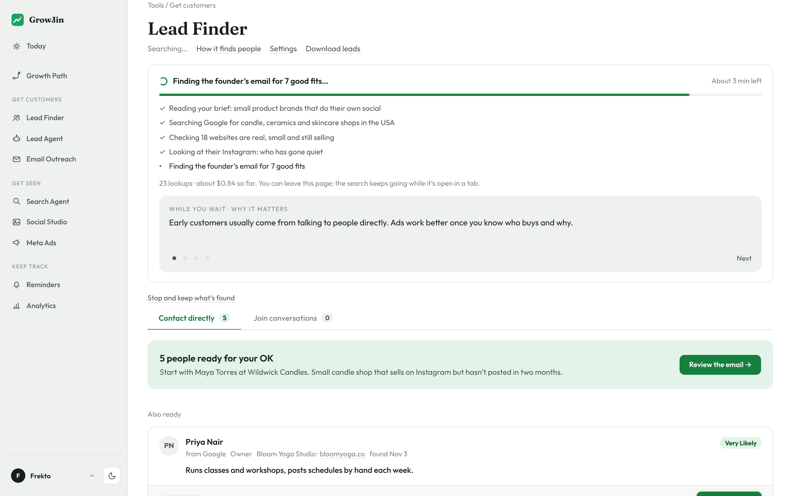
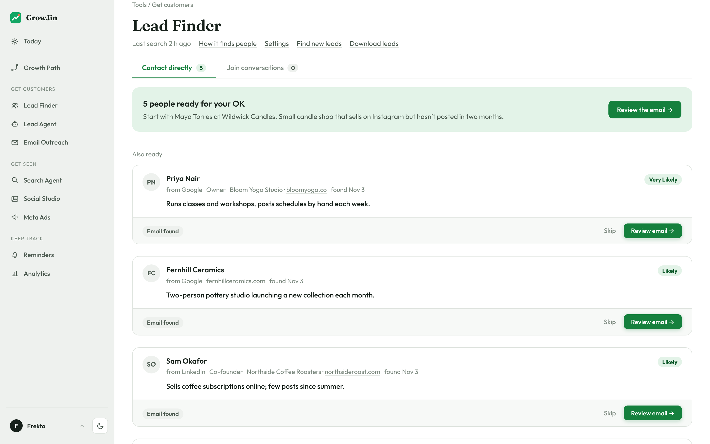
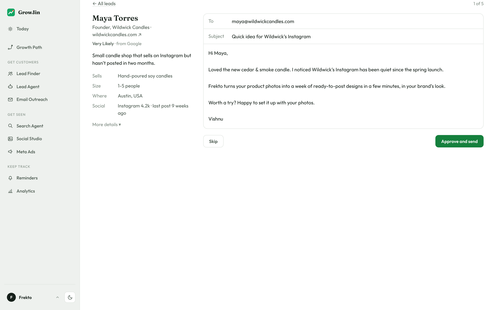

## Find small businesses that fit, and judge each lead in seconds

Describe your ideal customer and Lead Finder finds, checks and rates small businesses for you, with short leads and short emails.

### Highlights

**New: Lead Finder searches for you**
Write a short brief about who you want. Lead Finder searches Google, LinkedIn and Instagram for small businesses that fit, checks each one is real and still active, and finds the right person to email.

**Improved: Leads you can judge in seconds**
Every lead is rated from Very Likely to Very Unlikely. Open one and you see one line on why it fits and four short facts: what they sell, size, where, and social.

**New: Download your leads**
One click saves every lead you haven't contacted yet as a spreadsheet, ready for Google Sheets, Excel or your CRM.

### New
- Set industry, location, company size and who to contact
- Watch each search step live, with the cost so far
- Stop a search any time and keep what it found
- A tag shows if an email is a shared inbox or a guess

### Improved
- First emails are shorter: under 60 words
- Repeats, past contacts and opt-outs are left out
- More details sit behind "More details"

### Internal
- Release notes guide and Lead Finder write-up added
